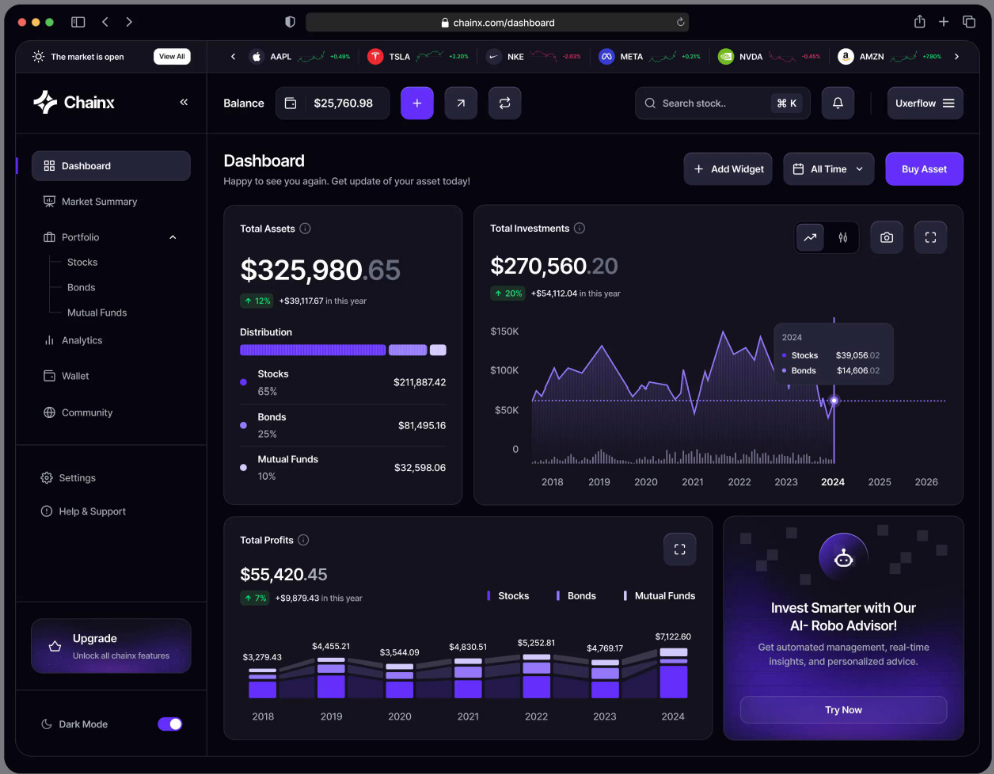
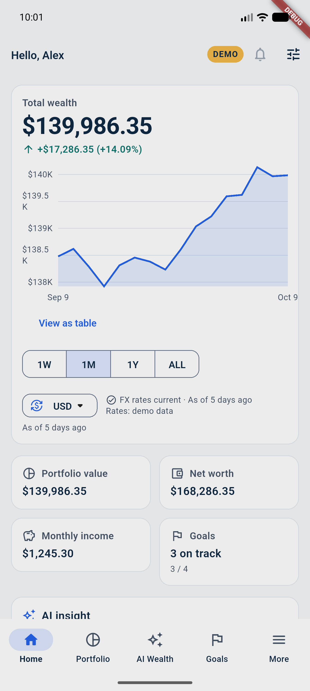
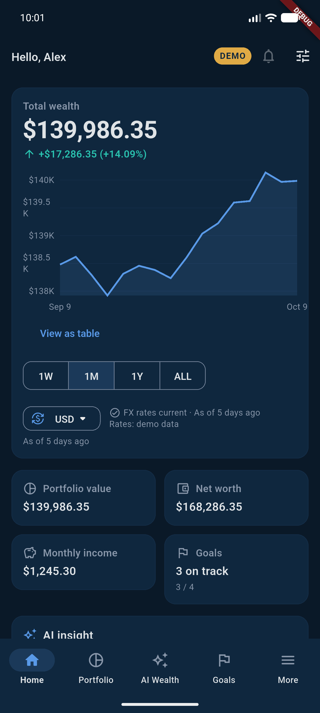
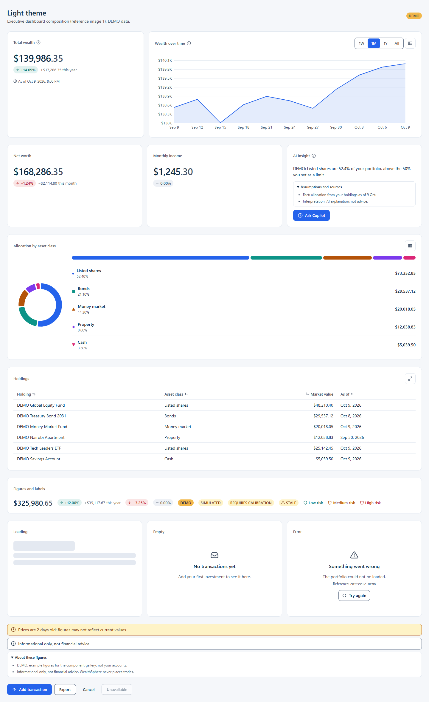
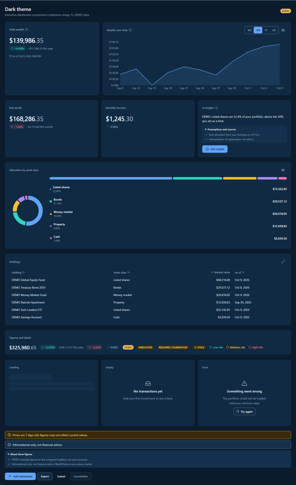

# Web portal: reference comparison sheets (P14-T03.6, QG-35.3)

**Date:** 2026-10-15. **Compared:** the design references and the web design system gallery (`/_gallery`, DEMO data) in light and dark. The gallery's sample dashboard is composed like reference image 1, so the visual language can be judged before the real pages exist. Later tasks add the full screens and repeat the comparison: the shell in P14-T06, the dashboard in P14-T07, the forex workspace in P14-T24, and the final review in P14-T20.6.

## Before and after

| | Light | Dark |
|---|---|---|
| **Reference** (dark only) | — |  |
| **Before**: the product today (mobile Home, DEMO). No web portal existed |  |  |
| **After**: web design system, 1440 px |  |  |

The other widths (1280, 1024, 768 and 375 px) are in [docs/design/screenshots/p14/after/P14-T03](../design/screenshots/p14/after/P14-T03).

## What follows the reference

| Reference pattern ([analysis](WEB_DESIGN_REFERENCE_ANALYSIS.md) §4) | In the design system |
|---|---|
| Layered dark surfaces, 1 px low-contrast borders, no heavy shadows | `scaffold` → `surface` → `surfaceElevated` tokens; cards with a `divider` border and no shadow |
| Card title bar: label with an info icon, compact actions on the right | `Card` (title, `info`, `actions`); chart cards add the "view as table" button |
| Large tabular figures with dimmed cents | `CurrencyAmount`: the major part in the text colour, the minor part muted, tabular figures |
| Change pill followed by the period delta | `ChangeIndicator`: sign, arrow, percentage and amount; tinted pill in the positive or negative role |
| KPI column beside a wide performance chart | Gallery grid: `KpiCard` (1/3) beside `PerformanceLineChart` (2/3) at 1280 px and wider |
| Distribution: segmented bar and a list with percentage and amount | `DistributionBar` (also beside `AllocationDonutChart`) |
| Chart chrome: muted grid, dashed crosshair, dark tooltip card, range selector | ECharts option: grid in `chartGrid`, axis in `textMuted`, tooltip on `tooltipSurface`; `SegmentedControl` for the period |
| Radii about 12 px for cards and 8 px for controls | `--ws-radius-card: 12px`, `--ws-radius-control: 8px` (mobile `AppRadii.small` is 12) |

## Intentional differences (approved decisions)

| Difference | Reason |
|---|---|
| Navy surfaces and the blue accent instead of near-black and violet | DEC-39: the shared WealthSphere tokens are kept on every channel. Violet remains a chart series |
| No "Buy Asset", quick-trade buttons, wallet balance or robo-advisor promotion | No trade execution and no advice (CLAUDE.md; analysis C5 and C6). The primary action is "Add transaction"; the promotion slot is "AI insight" with its assumptions and the not-advice notice |
| No stock ticker strip | Analysis C7: the data-status chip takes its place in the top bar (P14-T06) |
| Markers (●, ■, ▲, …) beside every series colour, and words for gains, losses and risk | Colour is never the only signal (WCAG 1.4.1) |
| A light theme | The references are dark only; the light theme mirrors the mobile light palette |
| Body text 14 px (16 px under 768 px); dense grids keep 36 px rows | Analysis C3: legibility and WCAG 1.4.4 over the trading terminal's 10 to 11 px |

## Checks behind the sheets

- Token contrast: `python scripts/generate_tokens.py --check` measures every text pair at 4.5:1 or better and every icon, border, focus and chart-series colour at 3:1 or better, in both themes.
- `web/e2e/gallery.spec.ts`:
  - axe finds no serious or critical WCAG 2.2 AA violation in either theme;
  - money columns sort exactly and announce `aria-sort`;
  - charts can be read as tables;
  - the period selector works with the keyboard;
  - there is no horizontal overflow at 1440, 1280, 1024, 768 or 375 px.
